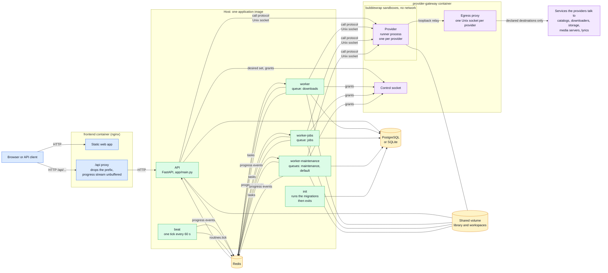
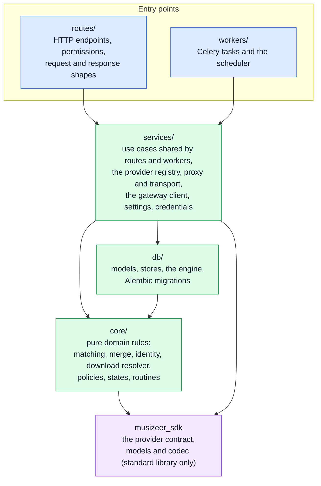
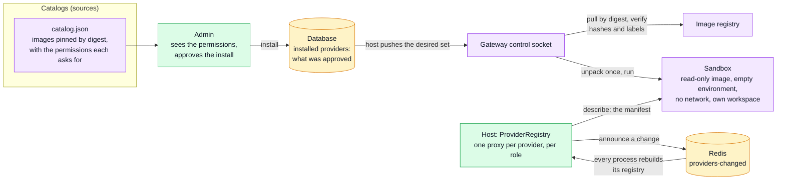
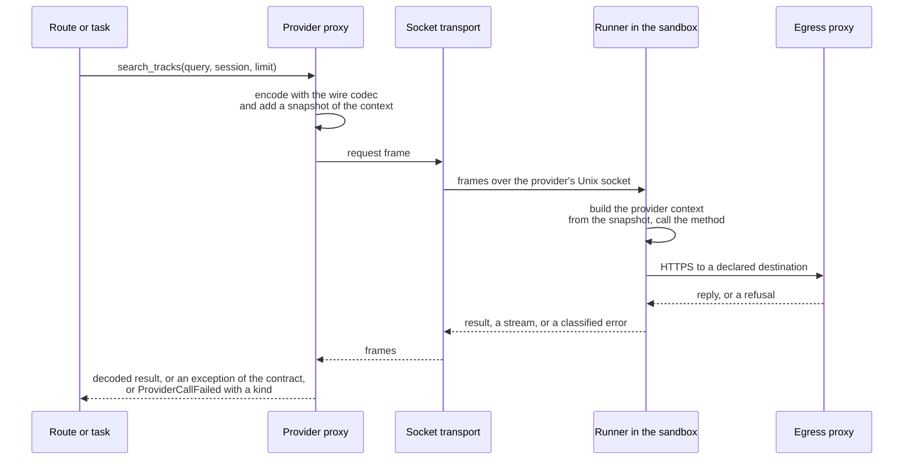
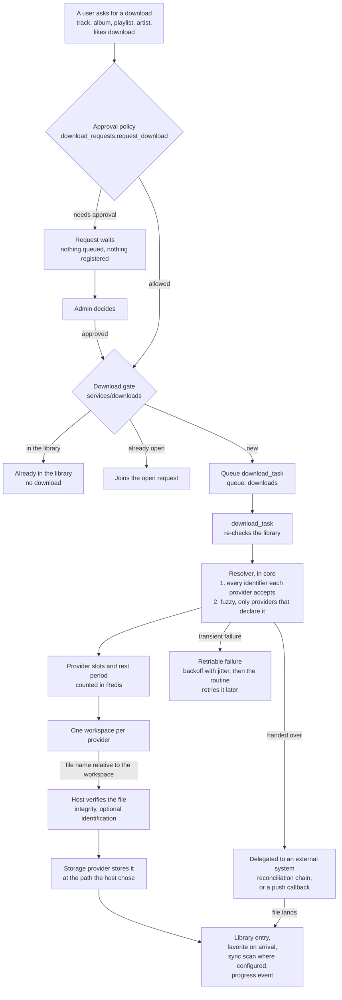
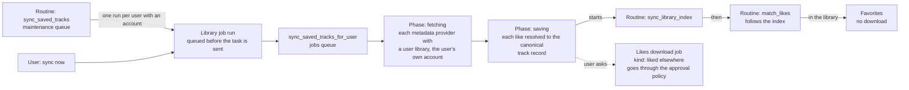

# Architecture overview

This page is the map of Musizeer: the processes that run, how a request travels through them, how the providers are
isolated, and how the main flows work. It is an overview. Each part links to the document that holds the detail, and the
rules the code is held to are in the guide at the root of the repository and in the
[decision records](adr/README.md).

Two ideas explain most of the rest:

- **The host decides, the providers return data.** The host (the API, the workers, the database) holds the library, the
  users, the settings and the credentials, and makes every decision: matching, retries, approvals, what is "in the
  library". A provider is a separate program that answers questions about its own service and returns data.
- **The host and the providers never share a process.** Every provider is an OCI image that the *provider gateway* runs
  in its own sandbox. The host calls it over a Unix socket with a small, versioned protocol, and the sandbox has no way
  out other than the destinations the provider declared. Neither side knows how the other works: the host does not know
  which providers exist, and a provider does not know about Redis, the database or Celery.

## The system at a glance

How to read it:

- A request goes **browser → nginx → API**. nginx serves the static web app and forwards `/api/*` to the API.
- The API answers what it can at once, and **queues the long work in Redis**. Three workers (one per queue) take it,
  and a single beat wakes the periodic routines.
- Everything persistent is in the **database** (PostgreSQL, or a SQLite file). **Redis** carries the queues, the
  progress events, the providers-changed event and a few counters. The files are on a **shared volume**.
- Whenever the host needs something from a provider, it sends a **call** to that provider's sandbox through the
  **gateway's socket directory**. The gateway is not on the data path of a call; it builds the sandboxes, filters what
  they can reach and reports what runs.

## Runtime

`docker-compose.yaml` runs the images published on GHCR (`musizeer`, `musizeer-gateway`, `musizeer-frontend`).
`docker-compose.build.yml` builds them from the checkout and `docker-compose.dev.yml` mounts the sources.
[`deployment.md`](deployment.md) is the guide to running it.

| Service | What it is |
|---|---|
| `frontend` | nginx. Serves the static web app and proxies `/api/` to `BACKEND_URL` (default `http://app:8000`), resolving the name again every few seconds so a recreated API container is found. It drops the `/api` prefix, forwards the original scheme and host, and gives `/api/progress` (server-sent events) no buffering and an hour of silence. |
| `app` | The API (uvicorn). Healthy when `/health` answers and says the database answers. |
| `worker`, `worker-jobs`, `worker-maintenance` | The three Celery workers, one per queue ([Background work](#background-work)). |
| `beat` | The one beat. In development it is embedded in `worker-maintenance` (`-B`). |
| `init` | Applies the database migrations and exits. The API, the workers and beat start after it succeeded. It does not scan the library: that needs providers, which only run once the API has told the gateway what is installed. |
| `provider-gateway` | Runs the providers ([The provider gateway](#the-provider-gateway-and-the-sandboxes)). Never `privileged`; it needs a seccomp profile and `systempaths=unconfined`. |
| `postgres`, `redis` | The database and the broker. |

Volumes: `data` (the application's state), `downloads` (the library and the workspace directory, mounted by the
application, the workers and the gateway), `provider_sockets` (the control socket and the providers' sockets, mounted by
the gateway, the API and the three workers only), `gateway_state` (the gateway's image cache), `postgres_data` and
`redis_data`.

## The API

The API is a FastAPI application. It is split into layers with a one-way dependency, and
`app/tests/test_layering.py` fails if an import goes the wrong way.

- **`routes/`** are thin: they authenticate the caller, check what the caller may do, call a service and shape the
  answer. They group as authentication and accounts, catalog browsing (search, artists, albums, tracks, playlists),
  downloads and requests, the library (favorites, jobs, duplicates), playlists, settings and providers, sources (the
  catalogs of providers), administration, and system (health, the progress stream, routines, updates). Every route is
  described in `app/openapi.yaml`, served at `/openapi.yaml`.
- **`services/`** are the use cases that routes and workers share. They are also where the host meets the providers:
  the registry, the proxy, the socket transport and the gateway client live here. A service never imports a route, and
  reaches a Celery task only by its registered name (`celery.send_task`).
- **`core/`** is domain logic with no I/O: it imports the SDK and never the database, services, routes or workers.
  The same function therefore decides the same thing wherever it is called.
- **`db/`** holds the SQLModel models, the stores, the engine and the migrations. One module sets the engine up for
  both PostgreSQL and SQLite ([`postgresql.md`](postgresql.md), [`migrations.md`](migrations.md)).
- **No GET writes to the database.** Reading only annotates what is there; jobs write
  ([ADR-0005](adr/0005-identity-data-and-reads.md)).
- **A provider failure is never a 500.** A failed call reaches the host as a contract exception or a
  `ProviderCallFailed` with a classified kind. Detail routes answer 404, 503 or 502 from it, and aggregated routes
  return the failures next to the results as `provider_errors`.

Who may do what is the subject of [`permissions.md`](permissions.md); authentication can be switched off, and then the
instance has one owner.

## Background work

Celery with Redis as broker and result backend, split in **three queues, each consumed by its own worker process**, and
one beat ([`workers.md`](workers.md)).

| Queue | Worker | What runs there |
|---|---|---|
| `downloads` | `worker` | `download_task`: resolve, download, verify, store. Concurrency is the `max_concurrent_downloads` setting. |
| `jobs` | `worker-jobs` | The library jobs a user starts (import likes, download the likes missing from the library), the library index, the import of an existing library, the full-sync check. |
| `maintenance` | `worker-maintenance` | The scheduler tick, every other routine, the reconciliation chains, short tasks queued by the others. It is also the default queue and consumes `default` to drain old messages. |

- Tasks are routed **by name** in one table (`workers/celery_app.py`, `TASK_ROUTES`), because services queue by name.
  A task with no route goes to `maintenance`, never to the downloads.
- **Beat only sends one message**, `workers.routines.tick`, every 60 seconds. The tick reads the current settings and
  decides which **routines** are due (library index, likes sync, playlists, retries of transient failures, library
  reconciliation, workspace sweep, update check...), so enabling a routine or changing its interval needs no restart.
  A routine run is a row (`queued → running → ok | error | skipped`); a routine can *follow* another, and one can be a job
  done once.
- **Each process that runs tasks builds its own provider registry** and follows the providers-changed event, because a
  forked child must not inherit a frozen copy.
- Workers fail what their predecessor left in flight on *their* queue when they start, and refresh a heartbeat per
  queue in Redis, so a job queued while no worker is alive fails as such instead of waiting forever.
- Progress is published on a Redis channel (download steps, library jobs, download-request decisions). The API's
  `GET /progress` turns it into **server-sent events**, filtered per viewer: a user only receives the events of what
  they can see.

## Data

| Store | What it holds |
|---|---|
| **PostgreSQL** (the default) or a **SQLite** file | Users, sessions, settings, tracks and their identifiers (one table of identifiers), downloads and download requests, the library, favorites, playlists, installed providers and their sources, routine runs and library jobs. Every stored credential is sealed with `CREDENTIALS_KEY` ([`credentials.md`](credentials.md)). One code serves both engines ([`postgresql.md`](postgresql.md)); schema changes are Alembic migrations that run in `init` ([`migrations.md`](migrations.md)). |
| **Redis** | The Celery queues and results; the progress and providers-changed channels; the counters that let several processes agree: the slots of providers that limit concurrent downloads, the rest period of a failing provider, the workers' heartbeats and the sign-in rate limit. Nothing in Redis is the only copy of anything that matters. |
| **Shared volume** | The workspaces and, depending on the storage provider that is configured, the library. |

The stored URLs of covers and streams are never absolute: they are references the API turns into URLs of the moment
([ADR-0004](adr/0004-stored-host-url-references.md)), so the public address can change without rewriting the data.

## The provider gateway and the sandboxes

A **provider** is a program that implements one or more roles of the contract in `sdk/` (`musizeer_sdk`): metadata,
download, storage, sync, lyrics, identification. It lives in its own repository, is built into an OCI image on the base
image of this repository, is published on a registry, and is listed in a **catalog**. The core never names one.

- **Sources and catalogs** ([`catalog.md`](catalog.md)). An admin adds a source (the URL of a catalog, with a token if it
  is private), sees what each provider asks for (network destinations, folders, limits, roles) and installs it. What was
  approved is recorded; an update that asks for more must be approved again.
- **The database is the only record of what is installed.** The host *pushes* the desired set to the gateway at start,
  after every change, and whenever the gateway restarted. The gateway runs nothing until it is told.
- **The gateway** ([`gateway.md`](gateway.md)) pulls each image **by digest**, checks every hash and the
  `org.musizeer.provider.*` labels against what was approved, unpacks the layers once, and runs one long-lived process
  per provider in a **bubblewrap sandbox**: a read-only image root, a private `/tmp`, every namespace unshared, no
  capability, an empty environment, memory, file and task limits, and an inner seccomp filter. If no sandbox can be
  made, no provider runs: there is no unconfined fallback.
- **The registry** ([`services/provider_registry.py`](../app/services/provider_registry.py)) registers only the
  providers the gateway reports as running. It asks each one to describe itself, checks the answer against what the
  image declared, and registers a **proxy** under every role the manifest names. The proxy is what the rest of the host
  holds. Everything a provider declares (its settings, capabilities, which optional methods it implements) is read from
  the manifest and costs no call.
- **When the set of providers changes** (an install, a crash, a gateway restart), the API announces it on Redis and
  every process (the API and the three workers) rebuilds its registry.

### A call to a provider

- A call is a request frame: method, arguments, the **auth session** for this call, and a **snapshot of the provider's
  context** (its settings, the timeouts, the public URL prefix). The provider never calls back into the host, and a
  setting changed in the UI is seen by the next call.
- Every value goes through the lossless codec of the contract (`musizeer_sdk.wire`). Streams (a library listing, a
  file read) are produced as the host consumes them.
- The runner classifies a failure where the type of the exception exists (timeout, HTTP status, network), so the host
  reads a `kind` and never a provider's raw exception. A connection that cannot be opened or breaks is `unreachable`.
- **Versions.** The SDK's major version is the contract version. Within a major the contract only grows, and the two
  sides each encode for the other's minor version, so a provider built on an older minor keeps working
  ([ADR-0007](adr/0007-versions-compatibility-and-upgrades.md)).

### Egress: the only way out

A sandbox has **no network**. The one thing it can reach is the Unix socket of its egress proxy, through a relay the
runner starts on the sandbox's loopback and the standard proxy variables. The proxy allows:

- the fixed destinations of the manifest, which must resolve to **public** addresses (a host can be a wildcard for
  subdomains only);
- the destinations that the **current value of a setting** names (a server address the user typed, which may be
  private);
- for a protocol that is not HTTP, any port of the host that a setting names, or the declared range.

The proxy resolves the name itself and connects to the address it checked; loopback and link-local addresses are never
reachable. Because only the host knows the settings, the host *sends the gateway the grants* before a call whenever the
values change; the grants expire if the host stops renewing them. A sandbox cannot influence them. The detail is in
[`gateway.md`](gateway.md#egress).

### Workspaces: how files cross the boundary

A provider never sees a host path. For every call that produces or reads a file, the host creates an empty directory
under the workspace directory, **in the folder of that provider** (`<workspace_dir>/<provider>/<random>`), and passes
it in. The provider writes there and returns only a **name relative to it**. The sandbox of a provider sees only its own
folder, as `/workspace`. The host then validates what it finds (names that escape the workspace are rejected), decides
the final library path, and removes the workspace when the operation ends. A file that goes from one provider to
another (downloaded by one, stored by another) is staged into the second provider's folder for the duration of the
call. A provider that has to read or write the user's own folders declares which setting names them, and the gateway
grants those folders after checking them. See
[ADR-0003](adr/0003-provider-file-exchange-workspace.md) and [`gateway.md`](gateway.md#sockets-volumes-and-permissions).

## Main flows

### Search and enrichment

1. `GET /search` hands the query to the **search aggregator** (`core/search_aggregator.py`), which asks every enabled
   metadata provider **in parallel**, in the configured priority order, each with its own result limit. A slow provider
   does not block the answer: there is a wall-clock budget, and what answered in time is returned.
2. The results are merged: first by shared identifiers (ISRC, MBID), then by normalized title and artist
   (`core/matching.py`, `core/merge.py`). The provider with the highest priority wins a conflict on a field; the others
   fill what is missing.
3. For tracks, the host then looks for a **stream** it can play: the sync providers are asked for candidates
   (`SyncProvider.find_candidates`) and *the host* decides whether a candidate is the track
   (`services/enrichment.py`). This is bounded by a request budget.
4. The list is **annotated** from the database (`services/track_state.py`): download state, in the library or not, favorite,
   how it can be played. This only reads.
5. A provider that failed or was skipped is reported in `provider_errors`; the rest of the answer is still returned.

Detail pages (a track, an album, an artist) work the same way and cross-enrich the item from the other providers.
Identity is decided by the identifiers a record carries, with the version of a song (remix, live...) as part of its
title identity.

### Download: the gate and the resolution

- **One gate for every entry point.** Each user-facing way to ask for a download first goes through the **approval
  policy** (`services/download_requests.py`: automatic, needs approval, or automatic up to a number of tracks, with a
  quota per user and window), and then through the **download gate** (`services/downloads.py`). A track already in the
  library gets no new download, a track with an open request joins it, and the task receives the canonical track with
  all its identifiers. If the task cannot be sent, the download ends `failed` and retriable instead of staying pending
  forever. Admins and open mode are not governed. A retry is not a request.
- **Resolution** is the job of `DownloadResolver` in `core/`, used by the task. It tries every identifier each download
  provider accepts, then a fuzzy search on the providers that declare they can do one. A provider that declares a limit
  of concurrent downloads gets a **slot** from Redis first (so the limit holds across workers), and a provider that
  fails transiently several times in a row **rests** for a while. Each provider gets its own workspace.
- A provider answers in one of four ways: a file name, `None` ("I do not have it", definitive), an exception (upstream
  down, so it is retried), or a contract exception (the download was *delegated* to an external system, or declined
  with a reason).
- **The host then takes over**: it checks the file's integrity and, if enabled, that it is the song it should be,
  gives it to the **storage provider** to store at the library path the naming template gives
  (`services/library_paths.py`), verifies the result, and records the library entry. Provider code never places a file
  in the library.
- A **delegated** download stays `dispatched`. A reconciliation chain, a periodic sweep and, where the external system
  supports it, a push callback ([`delegation-webhook.md`](delegation-webhook.md)) follow it until the file lands.
- A failure that exhausted its retries stays retriable, and the `retry_transient_failures` routine queues a few of them
  again at each run.

The state the UI shows is one computed value (`file_state`), never an attempt's raw status.

### The library and the sync index

A track is **in the library** when a download landed, when the storage holds its file (found by a scan), or when a sync
provider indexed it. Where the music physically lives is the storage provider's business; the host keeps the records.

- **Import of an existing library** (`import_existing_library`). A routine, not part of `init`: it waits, run after run,
  until a storage provider answers, then lists the storage's files, reads their tags and creates the records. It is done
  once the flag is set; "Run now" scans again and adds only the new files.
- **The sync index** (`sync_library_index`, on the `jobs` queue). It lists the *whole* library of every sync provider
  and gives each file a record carrying its sync id. A sync id the provider no longer lists is dropped only when the
  record stays explained, and never on an empty or partial listing, which fails the run with a stable code instead.
  It runs hourly, and right after a library scan or a likes sync. `index_track` asks about one track (the download
  worker, before it fetches a copy).
- **Reconciliation** (`reconcile_library_files`, off by default). Compares the library entries with what the storage
  holds: a moved file is found again, a vanished one marks the entry missing. It deletes nothing.

### Likes sync

- A likes sync is a **library job** (`services/library_jobs.py`): the run is persisted as `queued` *before* the task is
  sent, starting it is idempotent per user and kind, the worker claims it and reports generic progress (a phase, the
  provider, processed over total, one entry per provider), and a reaper fails runs that no worker will finish
  (`worker_unavailable`, `worker_lost`). The run fails only when every provider failed.
- It uses the user's **own account** on each provider, never a shared one.
- The imported likes then become favorites in two ways. **Like matching** (`match_likes`) runs after the library index
  and turns the ones that match tracks already in the library into favorites, downloading nothing. The **likes download**
  asks for the missing ones through the same approval policy as any other download.
- Taking a favorite off is remembered by the song's keys, so no sync or matching brings it back. Optionally, the
  user's setting takes the like off the origin provider too.
- A favorite propagates to the sync provider (`reconcile_pending_likes`) once the file is indexed there.

### Playlists

[`playlists.md`](playlists.md). A playlist belongs to its user and is private. It is either **own** (edited by the owner)
or **followed** (a read-only mirror of a provider's playlist, which can be duplicated into an own one).

- Following keeps the tracks and asks for their download through the approval policy; they are never favorites.
- `refresh_followed_playlists` compares each followed playlist with its source (the provider's version marker, read
  with the owner's accounts) and applies the difference: new tracks are asked for, tracks that left the source leave the
  playlist, files stay.
- `sync_playlists` mirrors every user's playlists onto their own account on each sync provider that keeps playlists,
  only with the tracks that provider already indexed, so it follows the library index. An edit of a playlist starts it.
- Every edit runs under a lock of that playlist, and a size cap applies.

### Authentication and accounts

There are **two different things** called an account, and they never mix.

1. **Users of Musizeer** ([`permissions.md`](permissions.md)). Authentication can be off, and then the instance is one
   owner. With it on, users sign in with a password, or through a linked provider account
   ([`provider-login.md`](provider-login.md)); a session is a short-lived access token plus a rotating refresh token.
   The roles are admin and user, and the UI reads *capabilities* from the server instead of applying rules itself.
   The key that signs sessions is `AUTH_SECRET`.
2. **Accounts at the providers' services**. Each provider *declares* whose account it works with
   (`AccountModel`: none, personal, personal with a shared fallback, or system) and how it signs in (OAuth2, a login
   form, an API key, or a program that captures it). One rule routes every *read* of a credential, and a *write* always
   says whether it is personal or shared. Each call receives the `AuthSession` the credential produces; the provider
   never sees the key that seals the stored credentials ([`credentials.md`](credentials.md)). OAuth2 flows are declared
   as data that the host executes, so a provider cannot ship auth code to the host.

Some work is done for the instance rather than for a user (a download uses the shared accounts). Work done on a
user's own data (importing their likes, mirroring their playlists) uses only that user's own account.

## Where to read more

| Topic | Document |
|---|---|
| Running it, secrets, the public URL, folders, upgrades | [`deployment.md`](deployment.md) |
| The gateway, the sandbox, egress, folders, the control socket | [`gateway.md`](gateway.md) |
| Sources, catalogs, what the admin approves, publishing | [`catalog.md`](catalog.md) |
| Writing a provider | [`provider-authors.md`](provider-authors.md) |
| Queues, workers, beat, routines | [`workers.md`](workers.md) |
| Users, roles, capabilities, the permission matrix | [`permissions.md`](permissions.md) |
| Stored credentials and the key | [`credentials.md`](credentials.md) |
| Signing in through a provider | [`provider-login.md`](provider-login.md) |
| Playlists | [`playlists.md`](playlists.md) |
| PostgreSQL, and moving from SQLite | [`postgresql.md`](postgresql.md) |
| Database migrations | [`migrations.md`](migrations.md) |
| Push callback of delegated downloads | [`delegation-webhook.md`](delegation-webhook.md) |
| The decisions behind all of it | [`adr/`](adr/README.md) |
